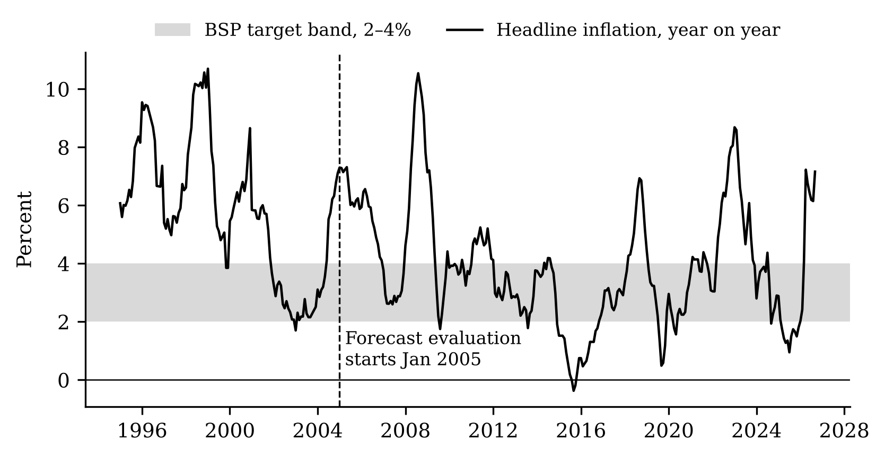
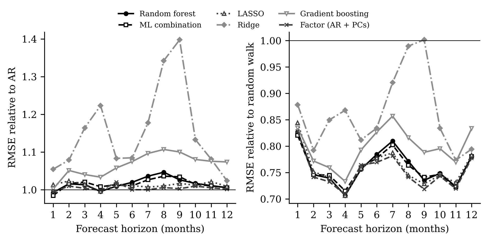
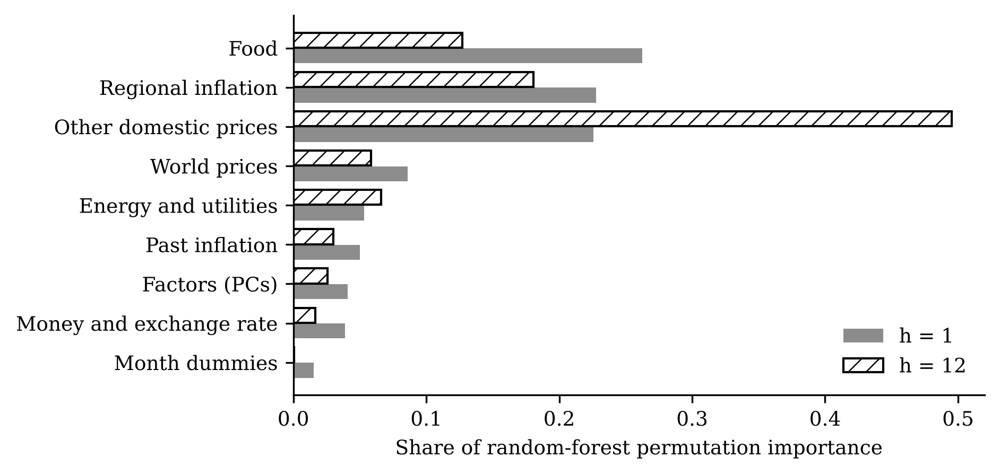
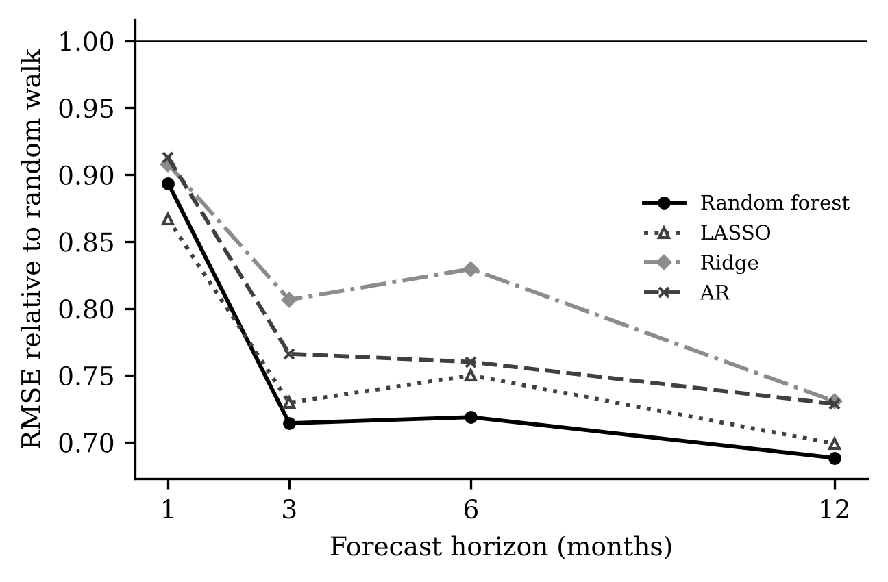
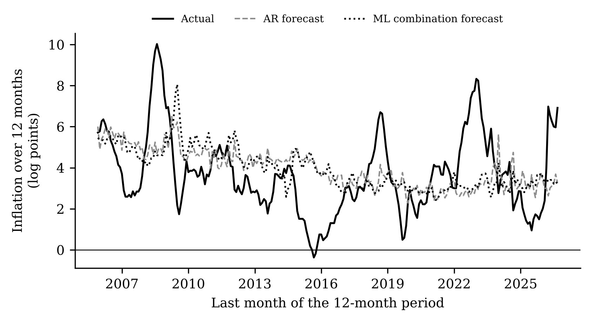

[^aff]: University of Southeastern Philippines, Davao City, Philippines. E-mail: lrcataytay00745\@usep.edu.ph.

# Introduction

Inflation forecasts sit at the centre of monetary policy. The Bangko Sentral ng
Pilipinas (BSP) has targeted inflation since 2002, and under a forward-looking
regime the policy rate responds to where inflation is *expected* to be one to two
years ahead, not where it is today. A better forecast therefore means better-timed
policy. The Philippine case is also a hard one. Food is
34.8% of the consumer basket and rice alone is 8.9%
(Philippine Statistics Authority, 2018 weights). Rice and oil are largely
imported, and typhoons hit farm output every year. As a result, Philippine
inflation swings much more than inflation in advanced economies. Since 2005 it
has left the 2–4% target band in 56% of months
(Figure 1), and the most recent episode, an oil-price shock in early 2026, pushed
it to 7.2% in September 2026. These features are common
across emerging Asia: rice is the staple, food takes a large share of household
budgets, and most economies import their oil. The Philippine evidence is
therefore a useful test case for other Asian central banks that are weighing
whether to add ML tools to their forecasting toolkits.

Machine-learning (ML) methods promise better forecasts when there are many
possible predictors. They do this in two ways: they *shrink* or *select* among
predictors so that noise does not swamp the signal, and some of them (tree-based
methods) also capture *nonlinear* relationships. The most influential evidence is
@medeiros2021. Using about 120 US macroeconomic series, they find that a
random forest (RF) forecasts US consumer price inflation more accurately than
the standard benchmarks at every horizon, and that the gains are largest when
uncertainty is high. Similar comparisons for Brazil [@garcia2017; @araujo2023]
and for a broad set of US variables [@gouletcoulombe2022] support the view that
ML helps. But the classic finding of inflation forecasting points the other way:
simple univariate benchmarks are very hard to beat [@atkeson2001; @stock2007;
@faust2013].

This paper asks which of these two findings holds for the Philippines. We
replicate the design of @medeiros2021 on official monthly data from the
Philippine Statistics Authority (PSA), 1994–2026, and compare five ML models,
their combination and a factor model with three benchmarks over
260 out-of-sample months (January 2005 to August 2026). We ask three
research questions. RQ1: are the ML models more accurate than the benchmarks?
RQ2: which predictors carry the gains? RQ3: are the gains larger in
high-inflation periods?

The paper makes three contributions. First, to our knowledge it is the first
systematic evaluation of data-rich ML inflation forecasts for the Philippines,
using the full detail of the PSA consumer price index (CPI): 13 food and energy
classes, the remaining divisions and groups, and all 18 regional indices.
Second, the design was *pre-registered*. The research questions, models,
hyperparameters, evaluation sample, tests and robustness checks were written
down and committed to a public version-control history before any Philippine
forecast was computed. A replication of the reference paper's main finding on
US data served as a gate that had to pass before we could proceed. This
guards against the "garden of forking paths" that is common in horse races
between many models. Third, we show *where* the gains come from: which groups of
predictors matter and in which inflation regimes.

The answer is clear and goes against the US evidence. All models beat the random walk by a wide margin; the AR's error is 17% smaller one month ahead. But no ML model is more accurate than the AR benchmark. The best of them, the equal-weight ML combination, has a relative RMSE of 0.98 one month ahead and 1.03 for inflation over the next year, and none of the Diebold–Mariano tests rejects equal accuracy. The random forest, the winner in the US, has relative RMSEs of 0.99 to 1.04 at these cases. The same code reproduces the random forest's advantage on US data, so the difference lies in the data, not the implementation. Food and regional prices carry most of the random forest's short-horizon signal, but that signal is already contained in past headline inflation. The ML gains do not grow in high-inflation periods. We read these results as support for the long-standing view that simple benchmarks are hard to beat [@atkeson2001; @stock2007], in a setting where supply shocks dominate inflation and are hard to predict.

The rest of the paper is organised as follows. Section 2 describes the data,
Section 3 the models and the evaluation, and Section 4 the replication gate.
Section 5 presents the results by research question, Section 6 the robustness
checks, and Section 7 discusses the findings and concludes.

# Data

**Target.** The target is monthly headline inflation, defined as the log change
of the all-items CPI for all income households (2018 = 100):

$$\pi_t = 100 \times \ln\left(\frac{P_t}{P_{t-1}}\right). \qquad (1)$$

For example, if the CPI rises from 120.0 to 120.6, then
$\pi_t = 100 \ln(120.6/120.0) \approx 0.50$, a monthly rate of about half a
percent. Inflation over the next $k$ months is the sum
$\pi_{t+1} + \dots + \pi_{t+k}$. For $k = 12$ this is, to a close
approximation, the year-on-year rate that the BSP targets. We use the official
series, which is not seasonally adjusted. All models therefore include month
dummies and twelve lags of inflation, so that regular patterns such as higher
prices every December do not show up as forecast errors.

The PSA publishes the 2018-based CPI from January 2018 and its *own* backcasts
of the same indices on the same base for January 1994 to December 2017. We join
the two without any rescaling. The January 2018 change in headline inflation at
the join is ordinary: it lies 0.11 standard deviations from the
average January change. Our computed year-on-year inflation matches the PSA's
published rates for every month from 2019 to September 2026 to within
0.05 percentage points.

**Predictors.** The predictor set contains 86 monthly series that
are complete from February 1994 to July 2026. Table 1 lists them by group.
They are the 13 COICOP divisions and their groups in the national CPI, the food
classes (cereals, meat, fish, dairy, oils, fruit, vegetables, sugar and other
food) and rice, the energy classes (electricity, gas, solid fuels and motor
fuels), core inflation, and headline inflation in each of the 18 regions. They
also include world prices: Brent and Dubai crude oil, the International Monetary
Fund (IMF) all-commodities and food indices, wheat, maize, and Dubai crude in
pesos. Finally, they include the peso–dollar exchange rate, the BSP policy rate
and the US federal funds rate. Prices and the exchange rate enter as log changes
(as in Equation 1), and interest rates as first differences. Series that start
after 1994 are dropped, so that every model sees the same information. This
removes 16 small CPI groups and US CPI, whose October 2025 value was never
published.

| Group | Series | Content | Source |
| :----------------------- | --------: | :---------------------------- | :--------- |
| Food | 13 | Food and non-alcoholic beverages; Food; Non-alcoholic beverages; Cereals and cereal products (ND); Meat and other parts of slaughtered land animals (ND); Fish and other seafood (ND); Milk, other dairy products and eggs (ND); Oils and fats (ND); ... | PSA |
| Other domestic prices | 38 | Alcoholic beverages and tobacco; Alcoholic beverages; Tobacco; Non-food; Clothing and footwear; Clothing; Footwear; Housing, water, electricity, gas, and other fuels; ... | PSA |
| Energy and utilities | 7 | Water supply and miscellaneous services relating to the dwelling; Electricity, gas and other fuels; Operation of personal transport equipment; Electricity (ND); Gas (ND); Solid fuels (ND); Fuels and lubricants for personal transport equipment (ND) | PSA |
| Regional inflation | 18 | Bangsamoro Autonomous Region in Muslim Mindanao (BARMM); Cordillera Administrative Region (CAR); MIMAROPA Region; National Capital Region (NCR); Negros Island Region (NIR); Region I (Ilocos Region); Region II (Cagayan Valley); Region III (Central Luzon); ... | PSA |
| World prices | 7 | Brent crude, USD; Dubai crude, USD; IMF all-commodities index; IMF food price index; Wheat, USD/mt; Maize, USD/mt; Dubai crude in pesos | FRED |
| Money and exchange rate | 3 | US federal funds rate (change); Peso per US dollar; BSP policy rate (change) | BIS, FRED |

Table: Table 1. Predictors by group

::: {custom-style="Table Note"}
*Notes:* All series are monthly, Feb 1994 to July 2026. Prices and the exchange rate enter as 100 × log change, interest rates as first differences. The full list is in output/tables/predictor_groups.csv.
:::

# Forecasting models and evaluation

## Direct forecasts in a rolling window

We forecast inflation $h = 1, \dots, 12$ months ahead with *direct* forecasts.
For each horizon we fit a separate model that maps information available at
month $t$ into inflation at month $t+h$:

$$\pi_{t+h} = f_h(z_t) + \varepsilon_{t+h}, \qquad (2)$$

and the forecast made at origin $T$ is $\hat\pi_{T+h|T} = \hat f_h(z_T)$. The
information vector $z_t$ contains twelve lags of inflation, the current value
and three lags of every predictor (as in @medeiros2021), the first four
principal components of the predictors and their three lags, and eleven month
dummies, 383 features in all. The principal components are
recomputed in every window from data up to the origin only.

Each model is re-estimated at every origin on the most recent 120 months, a
*rolling window*. The window lets the models adapt to change, such as the start
of inflation targeting in 2002 or the 2018 rebasing, while keeping enough
months for estimation. The first origin is December 2004, so the first forecast
target is January 2005. Because the forecasts at each origin use only data
available at that origin, they are *pseudo out-of-sample* forecasts: they mimic
what a forecaster could have done in real time, apart from data revisions,
which are rare for the Philippine CPI.

## Models

There are three **benchmarks**. The *random walk* (RW) forecasts that inflation
in month $t+h$ equals this month's inflation, $\hat\pi_{T+h|T} = \pi_T$, as in
@medeiros2021. The *12-month-mean random walk* (RW-AO) of @atkeson2001
forecasts the average of the last twelve months. The *autoregressive* (AR)
model regresses $\pi_{t+h}$ on a constant, month dummies and $p$ lags of
inflation, with $p \le 12$ chosen by the Bayesian information criterion (BIC).
We treat the AR as the main benchmark because it is the stronger of the
two for a seasonal monthly series.

The **factor model** adds to the AR the first $k \le 4$ principal components of
the predictors [the *diffusion index* model of @stock2002], with $p$ and $k$
chosen by BIC.

Five **ML models** use all the features. *Ridge regression* [@hoerl1970]
shrinks all coefficients toward zero by penalising their squared size, with
the penalty chosen by leave-one-out cross-validation. The *LASSO*
[@tibshirani1996] penalises the absolute size of the coefficients, which sets
many of them exactly to zero and so *selects* predictors. Its penalty is chosen
by BIC. The *adaptive LASSO* [@zou2006] reweights the LASSO penalty using a
first-stage ridge estimate, so that strong predictors are penalised less. The
*random forest* [@breiman2001] averages 500 regression trees, each grown on a
bootstrap sample with a random third of the features considered at each split.
Trees split the data into regions and predict the regional average, so they
capture nonlinear effects and interactions without having to specify them.
*Gradient boosting* [LightGBM, @ke2017] grows small trees one after another,
each one fitting the errors left by the previous ones. Finally, the *ML combination*
is the equal-weight average of the five ML forecasts [@timmermann2006]. All
hyperparameters were fixed in advance (Appendix A) and never tuned on the
evaluation sample.

## Evaluation

Accuracy is measured by the root mean squared error (RMSE), the square root of
the average squared forecast error. We report it relative to a benchmark:

$$\text{Relative RMSE}_{m} = \frac{\text{RMSE}_m}{\text{RMSE}_{\text{AR}}}. \qquad (3)$$

A value of 0.90 means that model $m$'s typical error is 10% smaller than the
AR's. To judge whether a difference could be due to chance, we use the
Diebold–Mariano (DM) test [@diebold1995] with the small-sample correction of
@harvey1997. The test asks whether the average difference in squared errors is
zero, allowing for the overlap of multi-step errors. We report one-sided
p-values for "model $m$ is more accurate than the benchmark". Because we test
seven challengers at four cases, we also report p-values with a Holm correction
for multiple testing. In addition, we compute the 90% model confidence set (MCS)
of @hansen2011, the set of models that cannot be statistically distinguished
from the best one.

RQ1 is judged on four pre-specified *decisive cases*: one month ahead ($h = 1$),
twelve months ahead ($h = 12$), and inflation accumulated over the next three
and the next twelve months. A model *beats* a benchmark when its relative RMSE
is below one and the DM p-value is below 0.05. For RQ2 we measure each
predictor group's contribution with grouped permutation importance in the RF:
the rise in the training error when all of a group's features are shuffled
together. We report it as a share of the total, averaged over origins, for
$h = 1$ and $h = 12$, together with the share of origins in which the LASSO
selects at least one feature from the group. For RQ3 we split the target months
into *high-inflation* months, where year-on-year inflation exceeds 4% (the top of
the target band), and all others. We also plot cumulative squared forecast-error
differences over time [cf. @giacomini2010].

# Validation: the replication gate

Before any Philippine forecast was computed, we tested the code on the
reference paper's own setting. Using FRED-MD [@mccracken2016], US CPI inflation,
a rolling 360-month window, four lags of every series plus four principal
components, and out-of-sample months 2001–2015, we pre-registered three
criteria: (G1) the RF beats the RW at $h = 1, 3, 6, 12$; (G2) its RMSE averaged
across these horizons is below the AR's; and (G3) it has the lowest average
RMSE among RW, AR, ridge, LASSO and RF. The criteria are qualitative because
the paper's tables were not accessible when the gate was written.
All three criteria hold. The RF's RMSE relative to the RW is 0.89, 0.71, 0.72, 0.69 at h = 1, 3, 6 and 12; its RMSE averaged over horizons is 0.950 times the AR's; and it has the lowest average RMSE of the five models, although LASSO is close and is better than RF one month ahead. The random forest's advantage on US data is therefore reproduced by our code (Figure 6, Table A2).

# Results

## RQ1: Do machine-learning models beat the benchmarks?

Table 2 and Figure 2 give the main result. First, the random walk is a poor benchmark for monthly Philippine inflation. Its RMSE is 1.20 times the AR's one month ahead and 2.20 times for inflation over the next twelve months. It is excluded from the 90% model confidence set in every decisive case. Every other model beats it, and so would pass the criterion of @medeiros2021, who report results relative to the random walk.

Second, against the AR benchmark, no model wins. At $h = 1$ the relative RMSEs range from 0.98 (ML combination) and 0.99 (random forest) to 1.05 (ridge). The lowest one-sided Diebold–Mariano p-value across all seven challengers and four decisive cases is 0.32, far from any conventional threshold; after the Holm correction, the smallest is 1.00. Twelve months ahead the picture is the same: the ratios lie between 1.00 and 1.07. For inflation accumulated over the next three months, the combination and the random forest are about 2% more accurate than the AR (0.98 and 0.99), but for inflation over the next year they are worse (1.03 and 1.04). The model confidence set confirms that these differences are noise. The 90% set contains the AR in every case, together with almost every challenger. The models excluded are: Random walk and Random walk (12-month mean) one month ahead; Random walk and Gradient boosting twelve months ahead; Random walk for 3-month accumulated inflation; Random walk for 12-month accumulated inflation.

Third, the methods that use the predictors most aggressively do worst. Ridge regression, which keeps every feature, and gradient boosting are up to 40% and 11% less accurate than the AR at some horizons (Table A3). At long horizons the LASSO usually selects few or no features (Section 5.2), so its forecast stays close to the window mean and is about as accurate as the AR. The factor model is almost identical to the AR (relative RMSEs between 0.99 and 1.02 across all horizons). The AR itself almost always chooses a single lag (the median at every horizon), so the strongest forecast is little more than a recent mean plus seasonal dummies.

| Model | h = 1 | h = 12 | 3-month acc. | 12-month acc. |
| :--------------------------- | :---------------------------- | :---------------------------- | :---------------------------- | :---------------------------- |
| Random walk | 1.20 | 1.29 | 1.50 | 2.20 |
| Random walk (12-month mean) | 1.08 | 1.08 | 1.09 | 1.30 |
| AR | 1.00 | 1.00 | 1.00 | 1.00 |
| Factor (AR + PCs) | 0.99 | 1.00 | 0.99 | 1.00 |
| Ridge | 1.05 | 1.02 | 1.05 | 1.15 |
| LASSO | 1.01 | 1.01 | 0.99 | 1.01 |
| Adaptive LASSO | 1.01 | 1.01 | 0.99 | 1.01 |
| Random forest | 0.99 | 1.01 | 0.99 | 1.04 |
| Gradient boosting | 1.00 | 1.07 | 1.02 | 1.11 |
| ML combination | 0.98 | 1.01 | 0.98 | 1.03 |
| AR RMSE (log points) | 0.382 | 0.410 | 0.866 | 2.073 |
| In 90% MCS | AR, Factor (AR + PCs), Ridge, LASSO, Adaptive LASSO, Random forest, Gradient boosting, ML combination | Random walk (12-month mean), AR, Factor (AR + PCs), Ridge, LASSO, Adaptive LASSO, Random forest, ML combination | Random walk (12-month mean), AR, Factor (AR + PCs), Ridge, LASSO, Adaptive LASSO, Random forest, Gradient boosting, ML combination | Random walk (12-month mean), AR, Factor (AR + PCs), Ridge, LASSO, Adaptive LASSO, Random forest, Gradient boosting, ML combination |

Table: Table 2. RMSE relative to the AR benchmark, January 2005–August 2026

::: {custom-style="Table Note"}
*Notes:* Stars mark one-sided Diebold–Mariano tests (HLN correction) that the model is more accurate than the AR: \* 10%, \*\* 5%, \*\*\* 1%. 'acc.' = inflation accumulated over the next 3 or 12 months. The last row lists the models in the 90% model confidence set.
:::

## RQ2: Which predictors matter?

Figure 4 shows which predictor groups the random forest relies on. One month ahead, food prices carry 26% of the grouped permutation importance, regional inflation 23% and the other domestic CPI components 23%. World prices (9%), energy and utilities (5%) and money and the exchange rate (4%) matter much less. The LASSO tells the same story: it selects at least one food feature at 71% of origins and one regional feature at 72%, against 33% for world prices. Twelve months ahead, the random forest shifts toward the slow-moving domestic components (50%), and the LASSO selects far fewer features: the share of origins with any food feature falls to 14%, and with any other domestic feature to 30%.

H2 is therefore supported at short horizons, with one qualification. Food is the most important group one month ahead, but energy is not; the oil and fuel series matter less than regional and other domestic prices. And because the models that use these predictors do not beat the AR, the importance measures describe where the models find signal in the training data, not where they gain accuracy out of sample. The food and regional series co-move closely with headline inflation, so they largely repeat information that past inflation already contains. These importance measures are computed on the training windows and are descriptive.

## RQ3: When do the gains arise?

Since 2005, year-on-year inflation has been above 4% in 39% of months. Table 3 compares relative RMSEs in these months and in the rest. H3 predicts that the ML gains concentrate in the high-inflation months. They do not. One month ahead, the combination's relative RMSE is 0.98 in high-inflation months and 0.99 in other months, and the random forest's is 0.99 and 0.99. For inflation over the next year, the random forest is about as accurate as the AR in high-inflation periods (1.00) and worse in calm ones (1.07). That is a small relative advantage in turbulent times, but only because the AR is also bad then.

Figure 3 tracks the comparison over time. A rising line means the model is gaining on the AR. One month ahead, the random forest and the combination gain a little on the AR before 2008 and again in 2010–12, hold that small lead until 2020, lose it in the 2021–23 surge, and then swing sharply in the 2026 oil shock. No model saw the March–April 2026 jump coming (monthly inflation of 1.36% and 2.60%). But the AR then carried the April jump forward, forecasting 1.48% for May, when prices in fact fell (-0.51%). The ML models, which average over many predictors, gave a damped 0.62%. Twelve months ahead, the ML models lose ground in the 2022–23 surge and do not recover it. Figure 7 shows why accuracy is so hard to come by at this horizon. Both the AR and the ML combination forecast year-ahead inflation close to its recent average, mostly between about 3% and 5%, and neither anticipates the 2008, 2018, 2022–23 or 2026 episodes.

| Model | h = 1, high | h = 1, other | h = 12, high | h = 12, other | 3-month acc., high | 3-month acc., other | 12-month acc., high | 12-month acc., other |
| :----------------- | -----------: | ------------: | ------------: | -------------: | ------------------: | -------------------: | -------------------: | --------------------: |
| Random walk | 1.20 | 1.21 | 1.25 | 1.34 | 1.51 | 1.49 | 2.01 | 2.38 |
| Factor (AR + PCs) | 0.99 | 1.00 | 1.00 | 1.00 | 0.99 | 1.00 | 1.00 | 1.00 |
| Ridge | 1.02 | 1.12 | 1.01 | 1.05 | 1.08 | 0.99 | 1.16 | 1.13 |
| LASSO | 1.01 | 1.02 | 1.02 | 0.99 | 1.00 | 0.98 | 1.02 | 1.01 |
| Adaptive LASSO | 1.00 | 1.02 | 1.01 | 1.00 | 1.00 | 0.98 | 1.02 | 1.00 |
| Random forest | 0.99 | 0.99 | 1.01 | 0.99 | 1.02 | 0.94 | 1.00 | 1.07 |
| Gradient boosting | 0.99 | 1.03 | 1.07 | 1.08 | 1.04 | 0.97 | 1.04 | 1.18 |
| ML combination | 0.98 | 0.99 | 1.02 | 0.99 | 1.01 | 0.94 | 1.02 | 1.04 |
| Months | 102 | 158 | 92 | 158 | 101 | 158 | 92 | 158 |

Table: Table 3. RMSE relative to the AR in high-inflation and other months

::: {custom-style="Table Note"}
*Notes:* High-inflation months are target months in which year-on-year headline inflation exceeds 4%, the top of the BSP target band.
:::

# Robustness

Figure 5 and Table A4 report the four decisive cases under each pre-registered robustness check. The checks are: an expanding window; a 96-month window; a 180-month window; targets up to December 2019 only; only world prices and money as predictors; a dummy for the January 2018 join; core inflation as the target. Across these seven checks, the lowest relative RMSE among the challengers ranges from 0.94 to 0.98, and 2 of the 196 Diebold–Mariano tests against the AR reject at 5%. Taken together, the checks leave the conclusion largely unchanged, with one qualification. With rolling windows, the best model in each check is at most about 3% more accurate than the AR, the same small and insignificant margin as in the main specification. A shorter (96-month) or longer (180-month) window does not help the data-rich models: more data per window does not turn the small gains into significant ones. Leaving out the pandemic and the 2022–23 surge (targets up to December 2019) does not change the picture either, so the null result is not an artefact of recent shocks. Using only world prices and money as predictors makes gradient boosting and the random forest worse at the one-year horizon (1.20 and 1.07), which confirms that the world-price block on its own adds noise. The January 2018 join dummy changes nothing.

The qualification is the expanding window, which uses every month since 1994 at each origin and so gives the models the most data. One month ahead, the ML combination and gradient boosting are then about 5% more accurate than the AR (relative RMSEs of 0.95 and 0.94; one-sided DM p = 0.032 and 0.025). These are the only two of the 196 robustness tests that reject at 5%, and neither survives the Holm correction (p = 0.874 and 0.702). At the other three decisive cases the expanding-window ratios lie close to one. In this check, gradient boosting and the combination have the lowest one-month RMSEs of any model in any headline-inflation specification evaluated on the full sample (0.362 and 0.364, against 0.382 for the main AR). So more training data helps the flexible models a little at the shortest horizon, which supports the small-sample explanation in Section 7, but the gain is small and statistically fragile.

A second partial exception is core inflation, which excludes the most volatile food and energy items. With core inflation as the target, the random forest and the ML combination have relative RMSEs of 0.95 and 0.95 one month ahead, and the combination reaches 0.94 for inflation over the next three months (one-sided DM p = 0.061). This is significant only at the 10% level, and not after the Holm correction (p = 1.000). We read it as weak evidence that the ML models find some signal once the hardest-to-predict supply shocks are removed from the target. That fits the explanation in Section 7: the obstacle is the unpredictability of food and energy shocks, not a lack of model flexibility.

# Discussion and conclusion

We asked whether the data-rich ML methods that beat the benchmarks for the United States also help forecast Philippine inflation. On 260 months of pseudo out-of-sample forecasts, with a pre-registered design and code that reproduces the US result, the answer is no. All the models comfortably beat the random walk. None beats a simple autoregression with month dummies, and the differences among the better models are small and statistically insignificant. This is the outcome predicted by H1b, not H1a.

Why does the US result not carry over? We see three reasons, which the design lets us partly separate. First, the benchmark matters. Relative to the random walk used by @medeiros2021, all our models look good (ratios of 0.78 and lower at $h = 12$), which shows how much of the reported ML gain can come from a weak benchmark when inflation is noisy month to month. Second, the sample is short. A 120-month window gives about 120 observations for 383 features. With so few observations per feature, the flexible models fit noise (ridge and boosting) or shrink to the mean (LASSO). The 360-month windows available for the United States are not possible for an inflation-targeting regime that began in 2002. The expanding-window check supports this reading: with all the data since 1994, the ML combination gains about 5% on the AR one month ahead, the only marginally significant gain we find (Section 6). Third, and most importantly, Philippine inflation episodes are driven by supply shocks to rice, other food and oil that are themselves unpredictable a month or a year ahead. The predictors that carry signal are other prices that move at the same time as headline inflation, so they add little to its own history.

For forecasting practice, the results suggest that the effort should go into better information on the shocks themselves, not into more flexible models of the same monthly price data. Examples are crop and import data for rice, futures prices for oil, and scheduled changes in administered prices and excise taxes. For the BSP's communication, they suggest stating openly that year-ahead inflation forecasts carry wide uncertainty, which simple and complex models share. The ML combination does have one useful property: it reacts less to a single extreme month than the AR does, as in May 2026. This may make it a useful second opinion during a shock, which future work could evaluate with density forecasts.

Several extensions follow naturally. They include real-time vintages, density and quantile ('inflation at risk') forecasts, and forecasting the components separately and combining them bottom-up. Another is a comparison with the BSP's own published forecasts.

**Limitations.** We use final-vintage data. The CPI is rarely revised, but
the 2018 rebasing changed the index history, and the external series can be
revised. The evaluation sample is long for an emerging economy
(260 months) but contains only a handful of inflation episodes,
so the regime comparisons in RQ3 rest on few independent events. We fixed the
hyperparameters in advance instead of tuning them. This protects against
overfitting the evaluation sample, but it may understate what a carefully tuned
model could achieve. Finally, we do not compare with the BSP's own published
forecasts, which are made on a quarterly schedule with information we do not
observe. The replication gate is qualitative. It checks that our code
reproduces the reference paper's rankings and its random-forest advantage on US
data, not its exact numbers, which we could not access when the gate was
written.

# Declarations {-}

**Funding.** None. **Competing interests.** None. **Data and code availability.**
All data are public (PSA OpenSTAT, FRED, BIS). The raw downloads, the code that
rebuilds every number, table and figure from them, and the dated
pre-registration are in the replication package (`run_all.sh`).
**Pre-registration.** The design (research questions, models,
hyperparameters, evaluation sample, tests, robustness checks and the replication
gate) was committed before any estimate. Deviations are listed in Appendix B.

# References {-}

::: {#refs}
:::

# Appendix A. Hyperparameters and implementation {-}

| Model | Settings |
| :----------------- | :---------------------------- |
| AR, factor | OLS; p ≤ 12 lags and k ≤ 4 principal components by BIC; month dummies |
| Ridge | Standardized features; penalty from 60 values in [0.01, 10^5] by leave-one-out CV |
| LASSO | Standardized features; 100-value path; BIC with df < n/2 |
| Adaptive LASSO | As LASSO with weights 1/(|β_ridge| + 1/√n) |
| Random forest | 500 trees; a third of features per split; minimum leaf 5 |
| Gradient boosting | LightGBM; 500 rounds; learning rate 0.02; 15 leaves; minimum leaf 10; 80% row and column subsampling |
| All | Rolling 120-month window; direct forecasts; seed 20261015 |

Table: Table A1. Model settings (fixed before estimation)

# Appendix B. Decisions log and deviations from the pre-registration {-}

The full decisions log (D1–D13) is in the replication package (`CLAUDE.md`), with dates and labels. Three changes were made after the plan was written but before any estimate: world food and grain prices come from the IMF series on FRED because the FAO file was out of date (D9); food and energy classes were added so that H2 could be tested (D10); and US CPI was dropped because of a missing month (D11). One correction was made after the first run stopped with an error at its first origin, before any forecast was saved (D13). The out-of-sample period is defined by origin (December 2004 to July 2026), and the first few origins use every month available, at least 108, rather than exactly 120. The Holm correction covers seven challengers at four cases (28 tests per benchmark); the plan said eight challengers by miscounting. Everything in Section 5.3 after the regime table, including the discussion of the 2026 episode, is exploratory.

# Appendix C. Full results {-}

| Model | h = 1 | h = 3 | h = 6 | h = 12 |
| :------------- | --------: | --------: | --------: | --------: |
| AR | 0.913 | 0.766 | 0.760 | 0.729 |
| Ridge | 0.908 | 0.807 | 0.830 | 0.731 |
| LASSO | 0.867 | 0.730 | 0.750 | 0.699 |
| Random forest | 0.894 | 0.714 | 0.719 | 0.688 |

Table: Table A2. Replication gate on FRED-MD: RMSE relative to the random walk, 2001–2015

::: {custom-style="Table Note"}
*Notes:* US CPI inflation; rolling 360-month window; 180 target months per horizon.
:::

| Model / h | 1 | 2 | 3 | 4 | 5 | 6 | 7 | 8 | 9 | 10 | 11 | 12 |
| :--------------------------- | --------: | --------: | --------: | --------: | --------: | --------: | --------: | --------: | --------: | --------: | --------: | --------: |
| Random walk | 1.20 | 1.36 | 1.37 | 1.41 | 1.33 | 1.30 | 1.28 | 1.36 | 1.40 | 1.36 | 1.40 | 1.29 |
| Random walk (12-month mean) | 1.08 | 1.08 | 1.06 | 1.05 | 1.07 | 1.07 | 1.08 | 1.09 | 1.09 | 1.09 | 1.09 | 1.08 |
| AR | 1.00 | 1.00 | 1.00 | 1.00 | 1.00 | 1.00 | 1.00 | 1.00 | 1.00 | 1.00 | 1.00 | 1.00 |
| Factor (AR + PCs) | 0.99 | 1.01 | 1.00 | 1.00 | 1.02 | 1.00 | 1.00 | 1.01 | 1.00 | 1.01 | 1.01 | 1.00 |
| Ridge | 1.05 | 1.08 | 1.16 | 1.22 | 1.08 | 1.08 | 1.18 | 1.34 | 1.40 | 1.13 | 1.08 | 1.02 |
| LASSO | 1.01 | 1.02 | 1.01 | 1.00 | 1.01 | 1.01 | 1.01 | 1.01 | 1.02 | 1.01 | 1.02 | 1.01 |
| Adaptive LASSO | 1.01 | 1.02 | 1.01 | 0.99 | 1.02 | 1.01 | 1.00 | 1.01 | 1.02 | 1.01 | 1.02 | 1.01 |
| Random forest | 0.99 | 1.02 | 1.01 | 1.00 | 1.01 | 1.02 | 1.04 | 1.05 | 1.03 | 1.02 | 1.01 | 1.01 |
| Gradient boosting | 1.00 | 1.05 | 1.04 | 1.03 | 1.06 | 1.07 | 1.10 | 1.11 | 1.10 | 1.08 | 1.08 | 1.07 |
| ML combination | 0.98 | 1.02 | 1.02 | 1.01 | 1.01 | 1.01 | 1.03 | 1.04 | 1.03 | 1.01 | 1.01 | 1.01 |

Table: Table A3. RMSE relative to the AR at every horizon h = 1, ..., 12 (main specification)

| Specification | Model | h = 1 | h = 12 | 3-month acc. | 12-month acc. |
| :---------------------------- | :----------------- | --------: | --------: | ------------: | -------------: |
| Main | Factor (AR + PCs) | 0.99 | 1.00 | 0.99 | 1.00 |
| Main | LASSO | 1.01 | 1.01 | 0.99 | 1.01 |
| Main | Random forest | 0.99 | 1.01 | 0.99 | 1.04 |
| Main | ML combination | 0.98 | 1.01 | 0.98 | 1.03 |
| An expanding window | Factor (AR + PCs) | 0.98 | 1.00 | 1.00 | 1.00\* |
| An expanding window | LASSO | 1.02 | 0.98 | 1.01 | 1.00 |
| An expanding window | Random forest | 0.95\* | 0.98 | 0.96 | 0.98 |
| An expanding window | ML combination | 0.95\*\* | 0.98 | 0.96 | 0.98 |
| A 96-month window | Factor (AR + PCs) | 1.00 | 1.01 | 1.00 | 1.03 |
| A 96-month window | LASSO | 1.01 | 1.00 | 1.00 | 0.99 |
| A 96-month window | Random forest | 1.00 | 1.01 | 0.98 | 1.01 |
| A 96-month window | ML combination | 0.99 | 1.01 | 0.98 | 1.00 |
| A 180-month window | Factor (AR + PCs) | 1.01 | 1.00 | 1.01 | 1.00 |
| A 180-month window | LASSO | 1.00 | 1.00 | 1.01 | 1.01 |
| A 180-month window | Random forest | 0.99 | 0.99 | 0.99 | 1.03 |
| A 180-month window | ML combination | 0.97 | 1.00 | 0.99 | 1.01 |
| Targets up to december 2019 only | Factor (AR + PCs) | 0.97 | 1.00 | 0.98 | 1.01 |
| Targets up to december 2019 only | LASSO | 1.03 | 0.99 | 1.03 | 1.03 |
| Targets up to december 2019 only | Random forest | 0.98 | 0.98 | 1.00 | 1.09 |
| Targets up to december 2019 only | ML combination | 0.98 | 0.98 | 1.00 | 1.07 |
| Only world prices and money as predictors | Factor (AR + PCs) | 0.98 | 1.00 | 0.99 | 1.01 |
| Only world prices and money as predictors | LASSO | 1.01 | 1.01 | 1.00 | 1.02 |
| Only world prices and money as predictors | Random forest | 0.99 | 1.05 | 1.01 | 1.07 |
| Only world prices and money as predictors | ML combination | 0.97 | 1.04 | 1.00 | 1.05 |
| A dummy for the january 2018 join | Factor (AR + PCs) | 0.99 | 1.00 | 0.99 | 1.00 |
| A dummy for the january 2018 join | LASSO | 1.01 | 1.01 | 0.99 | 1.01 |
| A dummy for the january 2018 join | Random forest | 1.00 | 1.01 | 0.99 | 1.03 |
| A dummy for the january 2018 join | ML combination | 0.99 | 1.01 | 0.98 | 1.03 |
| Core inflation as the target | Factor (AR + PCs) | 0.99 | 1.04 | 0.98 | 1.00 |
| Core inflation as the target | LASSO | 1.01 | 1.00 | 1.02 | 1.00 |
| Core inflation as the target | Random forest | 0.95 | 1.01 | 0.94 | 1.00 |
| Core inflation as the target | ML combination | 0.95 | 0.99 | 0.94\* | 0.98 |

Table: Table A4. Robustness: RMSE relative to the AR at the decisive cases

::: {custom-style="Table Note"}
*Notes:* Stars as in Table 2. Each check changes one element of the main specification.
:::

# Figures {-}

{width=95%}

{width=100%}

{width=100%}

{width=85%}

{width=100%}

{width=75%}

{width=95%}
